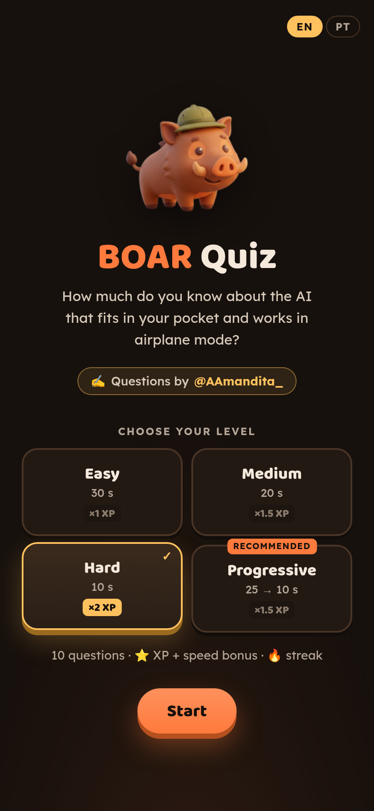
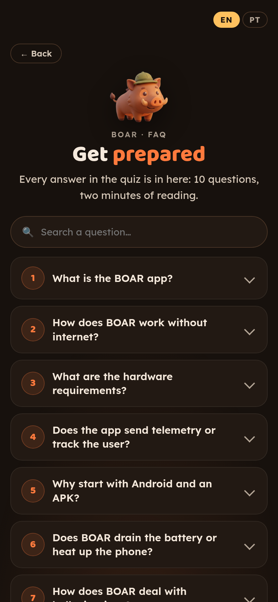
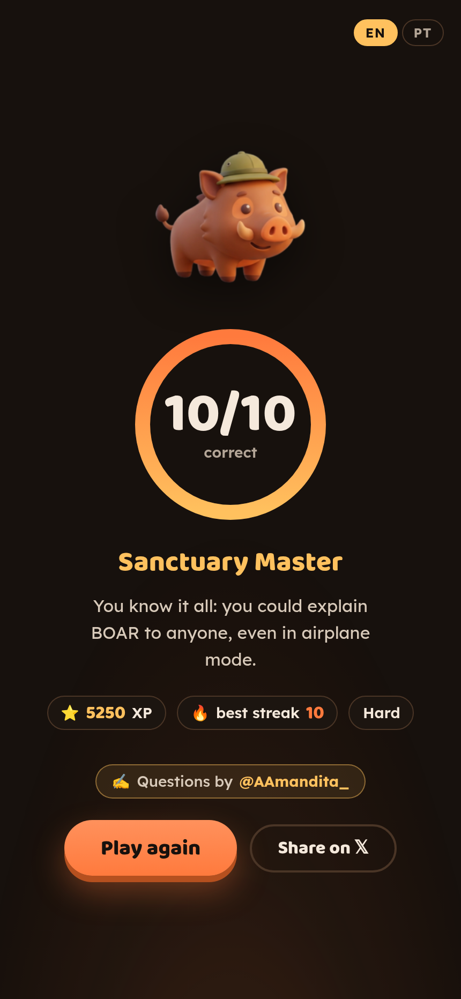

# BOAR · Quiz

> **Credits:** the BOAR FAQ and every question in this quiz were written by **[Amandita (@AAmandita_)](https://x.com/AAmandita_)**, based on her Zebra Talks interview with the BOAR team for the Zcash community. Thank you, Amandita! 🦓🐗

A short quiz about BOAR, in English (default) and Portuguese (`?lang=pt` or the EN · PT switch): 10 questions on offline AI, privacy, hardware, answer modes and the app. Get prepared first with the built-in FAQ (also at `#faq`): during the game, every answer links to its FAQ entry, and the results screen opens the ones you missed. One static page with self-hosted fonts: no tracking, no third-party requests.

About BOAR: **https://boarapp.com**

Play at https://boar-faq-quiz.vercel.app, or download the repo (**Code → Download ZIP**, or `git clone`) and open `index.html` in a browser. Keep the files together: the page loads `mascot.png` and `fonts/` from its own folder.

  
  &nbsp;
  
  &nbsp;
  

**Max score:** 10/10 on Hard, answering every question instantly: **5,250 XP**, best streak 10, rank *Sanctuary Master*.

## Interview highlights

From **Zebra Talks** (Zcash community, 1h 07m 58s): Amandita interviews the BOAR team. Translated from Portuguese and lightly edited from the automatic transcript.

**[0:07] Amandita:** Tell us, what is BOAR?  
**BOAR team:** "BOAR is nothing more than an Android app that runs AI 100% on your phone. Turn on airplane mode and nothing leaves. A free app you downloaded once will run on your Android forever. No monthly plan, it's private and it's yours."

**[0:17] Amandita:** What does it mean that it doesn't use the cloud and no data ever leaves the device?  
**BOAR team:** "It literally runs on the chip in your own phone. What Zcash does with your transaction, BOAR does with your questions, your queries, your conversations."

**[0:22] Amandita:** Why only Android?  
**BOAR team:** "Every first decision is the most private, the most secure and the most independent one first." The Play Store might block it in one place and the App Store in another, but any Android can get the APK.

**[0:39] Amandita:** How can we verify that nothing leaves the device?  
**BOAR team:** "Turn on airplane mode, that's the first step. Beyond that: don't trust, verify. Come read the code, come find our mistakes." The best way to help is to download and test.

**[0:45] Amandita:** Do backups take my chats to the cloud?  
**BOAR team:** "No. Nothing goes to the cloud. It's not an app that forces 100% privacy on you. It gives you 100% privacy by default." There is no BOAR server to receive anything: sanctuary technology.

**[0:50] Amandita:** How does it handle hallucinations? Can you check the facts?  
**BOAR team:** "It still hallucinates. It's the early stages of a technology that hallucinates less and less." With the right knowledge pack downloaded, it finds the source; without one, small models "don't know that they don't know."

**[0:55] Amandita:** What about battery, heat and speed?  
**BOAR team:** "It definitely eats battery and heats up, no escaping it. It's similar to running a video game with heavy graphics."

**[0:42] And the best metaphor of the night:** "If C-3PO and R2-D2 had been connected to the Empire's network, they would have turned evil. They're offline AIs. What we're building is C-3PO."

## FAQ

*By [@AAmandita_](https://x.com/AAmandita_). The answers reflect BOAR as of October 2026.*

**1. What is the BOAR app?**
A local AI assistant and offline search engine for smartphones, starting with Android. The models run 100% on the device, in airplane mode, without sending questions, history or data to outside servers.

**2. How does BOAR work without internet?**
The language model runs on the phone's processor (CPU) and RAM. The knowledge comes from the model itself, which is compressed (quantized), and from knowledge packs: local knowledge files such as Wikipedia, emergency manuals and guides, downloaded once or copied over a cable.

**3. What are the hardware requirements?**
Minimum: phones with 4 GB of RAM run the compact model, Qwen2.5-1.5B, which takes about 1 GB of storage.
Recommended: Qwen3-4B (about 2.5 GB) is the default on bigger phones and works best with 12 GB of RAM.

**4. Does the app send telemetry or track the user?**
No. There is no telemetry by default, no tracking, no crash reports and no collection servers. The only exception is the performance benchmark: you can choose to share an evaluation run (phone model, chip, scores and generation speed in tok/s, nothing that identifies you) on the public results.

**5. Why start with Android and an APK?**
The project was born from Vitalik Buterin's challenge (bounty #31 on poidh): a local AI that runs on GrapheneOS without depending on Google Play Services. The APK allows sovereign distribution that doesn't depend on app stores. An iOS version exists in a separate branch.

**6. Does BOAR drain the battery or heat up the phone?**
Yes. Running a model on the device itself demands a lot from the processor. Battery use and heat are comparable to a heavy game on the phone.

**7. How does BOAR deal with hallucinations?**
Smaller models can hallucinate on generic or complex questions. To reduce that, BOAR searches the knowledge packs before answering (local RAG), and every answer shows its sources and the excerpt the information came from, so you can check it.

**8. Where are my chats kept? Is there a cloud backup?**
The whole history stays on the device only. There is no sync and no automatic cloud backup (Android; on iPhone, app data can be included in your iCloud backup). If you delete the app or its data, the chats are removed from the phone for good.

**9. Do I need to buy the $BOAR token to use the app?**
No. The app is free and open source (MIT license), with no subscription and no token required.

## License

Code: [MIT](LICENSE). Fonts: Baloo 2 and Lexend, self-hosted under the [SIL Open Font License 1.1](fonts/OFL.txt).
